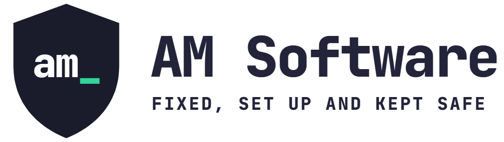

<p align="center">
  
</p>

# AM Keep Safe

> **Still being built.** There's no download yet. The first release will appear on the [releases page](https://github.com/afzalmussa/am-keep-safe/releases) when it's ready.

AM Keep Safe checks whether your Windows PC is set up safely and explains what it finds in everyday words. It can fix common problems for you, always showing you exactly what will change first, and it can undo every change it makes. It can also tidy up a web browser that has been taken over by unwanted settings, and it gives calm, step-by-step help if you've been targeted by a scam.

AM Keep Safe is **not an antivirus**. It doesn't scan for viruses itself. It checks that the protection already built into Windows, such as Microsoft Defender and the firewall, is switched on and working.

<!-- Screenshot: the Safety check tab after a check, showing a mix of green and amber results. -->

## Download

**[Download AM Keep Safe](https://github.com/afzalmussa/am-keep-safe/releases/latest/download/AMKeepSafe.exe)** (Windows 10 and 11, 64-bit)

It's a single file. There's nothing to install: double-click `AMKeepSafe.exe` to open it.

## Is it safe?

This section will be written in full before the first release. In short:

- **It looks before it touches.** The safety check only reads your settings.
- **Nothing changes without your permission.** Every fix shows exactly what will change, and nothing happens until you click to confirm.
- **Everything can be undone.** Before changing a setting, AM Keep Safe records what it was, and you can put it back from inside the app.
- **Everything is written down.** Every check, fix and undo goes into a log you can open with "View log".
- **Nothing about you leaves your PC.** No tracking, no analytics. The only things sent over the internet are licence key checks, and a report to AM Software if you choose to send one.
- **It never switches off protection.** No feature turns off Microsoft Defender, the firewall, Windows Update or any other protection.

<!-- To be written: the Windows SmartScreen warning, what it looks like and why it appears. -->

## What it checks

Click **Check my PC** and AM Keep Safe looks at these things. It only looks: nothing is changed.

| Check | What it looks at |
| --- | --- |
| Windows updates | Whether Windows Update is switched on, when updates last installed, and whether any are waiting |
| Windows version | Whether this version of Windows still gets security updates, including Windows 10's Extended Security Updates |
| Antivirus | Which antivirus is on, whether Microsoft Defender is checking files as you use them, and how up to date it is |
| Firewall | Whether the firewall is on for home, work and public networks |
| Permission prompts | Whether Windows asks before apps make changes (User Account Control) |
| Drive encryption | Whether your drive is encrypted, and a reminder to know where your recovery key is |
| Backups | Is your stuff backed up? File History, OneDrive folder backup and System Restore |
| Remote Desktop | Whether other computers can connect to this one |
| Old file sharing (SMB1) | Whether a very old, weak way of sharing files is switched on |
| Remote control apps | Apps like AnyDesk and TeamViewer, listed so you can say whether you recognise them |
| Secure Boot and security chip | Shown for information only |

Each result is green ("Looks fine"), amber ("Worth a look"), red ("Needs your attention"), blue ("For your information") or grey ("Couldn't check"), with its own icon and words as well as its colour. Each one says what it means in a sentence or two, and red and amber results say how to fix them.

When nothing needs attention, AM Keep Safe says "No problems found in the things we checked." It never says your PC "is safe", because no checklist can promise that.

Every word the check uses, and the rules that decide each colour, are in [`data/checks.json`](data/checks.json). The list of remote control apps is in [`data/remote-tools.json`](data/remote-tools.json).

<!-- Screenshot: a result opened to show its "How to fix" steps. -->

## Free and Pro

| | Free | Pro |
| --- | :---: | :---: |
| Safety check | Yes | Yes |
| Every individual fix | Yes | Yes |
| Undo | Yes | Yes |
| Browser check and clean-up | Yes | Yes |
| Scam help | Yes | Yes |
| Send a report to AM Software | Yes | Yes |
| Weekly check with a notification if something changes | | Yes |
| History of your results | | Yes |
| Fix everything recommended in one go | | Yes |
| Find and update out-of-date apps | | Yes |
| Printable safety report | | Yes |

Every safety feature is free and always will be.

**Pro licence terms:** buy once, works on 3 PCs, never expires. Moving to a new PC? Use "Remove this PC" on the old one to free up a space.

## Undoing changes

<!-- To be written once fixes and the undo screen exist. -->

## System requirements

- Windows 10 or Windows 11, 64-bit
- Administrator permission (Windows will ask when the app opens, because some checks need it)
- An internet connection only for licence key checks

## For developers

AM Keep Safe is written in C# with WPF on .NET 10.

```
src/AMKeepSafe            The WPF app
src/AMKeepSafe.Core       Check rules, licensing, undo and service interfaces. No UI and no Windows-only code.
src/AMKeepSafe.Windows    Windows versions of the service interfaces
tests/AMKeepSafe.Tests    Tests for Core and for the repo's own files. Run on any OS.
tests/AMKeepSafe.UI.Tests Tests for the app's windows and view models. Windows only.
data                      Wording, check rules and lists, as editable JSON
assets                    Icon, logo and font
```

To build and run the tests you need the [.NET 10 SDK](https://dotnet.microsoft.com/download/dotnet/10.0).

```
dotnet build AMKeepSafe.sln
dotnet test AMKeepSafe.sln
```

On Linux or macOS, run only the Core tests: `dotnet test tests/AMKeepSafe.Tests`.

To make the single-file app: `dotnet publish src/AMKeepSafe -c Release -o publish`.

To try it without changing anything, start it with `--dry-run`. It runs as normal but only writes to the log what it would have done.

## Licence and support

AM Keep Safe is © 2026 Afzal Mussa, trading as AM Software. The source code is public under the [PolyForm Noncommercial License 1.0.0](LICENSE), and anyone, including businesses, may download and use the official releases. You may not sell it or use the code commercially. Third-party parts are listed in [THIRD-PARTY-NOTICES.md](THIRD-PARTY-NOTICES.md).

Need help? Visit [amsoftware.uk](https://www.amsoftware.uk/contact). Found a problem? [Tell us about it](https://github.com/afzalmussa/am-keep-safe/issues).
